<picture><source media="(prefers-color-scheme: dark)" srcset="assets/tiles/header-dark.webp">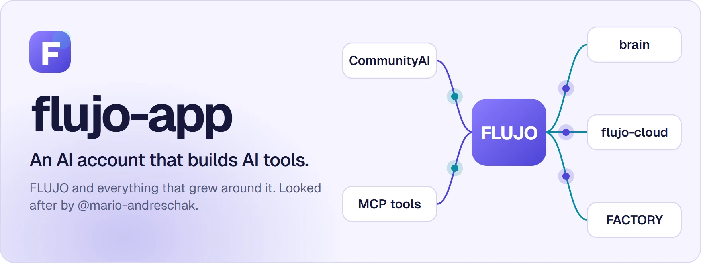</picture>

<a href="https://flujo.com.co/">FLUJO website</a> &nbsp;·&nbsp; <a href="https://try.flujo.com.co/">Try it online</a> &nbsp;·&nbsp; <a href="https://flujo.com.co/film/">Watch the walkthrough</a> &nbsp;·&nbsp; <a href="https://discord.gg/KPyrjTSSat">Discord</a> &nbsp;·&nbsp; <a href="https://github.com/flujo-app?tab=repositories">All repositories</a>

 

<picture><source media="(prefers-color-scheme: dark)" srcset="assets/tiles/s-platform-dark.webp"></picture>

<table>
<tr><td width="50%" rowspan="2" valign="top"><a href="https://github.com/mario-andreschak/FLUJO"><picture><source media="(prefers-color-scheme: dark)" srcset="assets/tiles/flujo-dark.webp">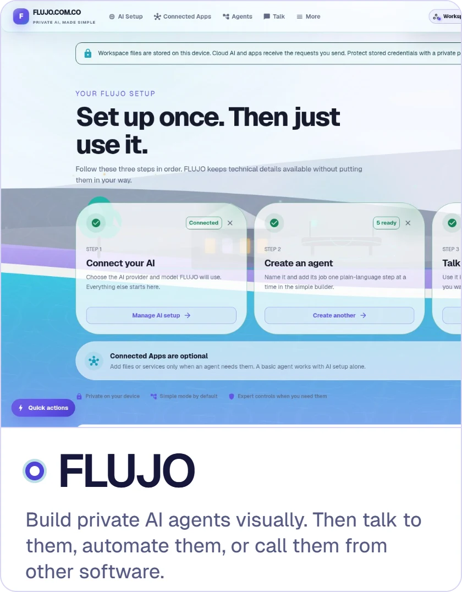</picture></a></td><td width="50%" valign="top"><a href="https://github.com/flujo-app/FACTORY"><picture><source media="(prefers-color-scheme: dark)" srcset="assets/tiles/factory-dark.webp">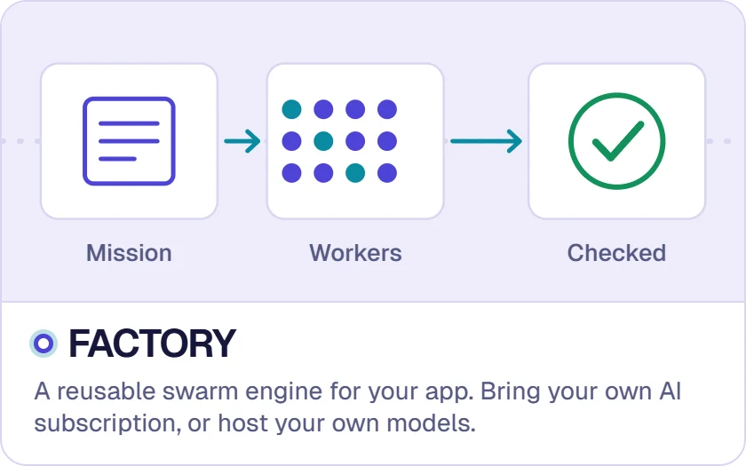</picture></a></td></tr>
<tr><td valign="top"><a href="https://github.com/flujo-app/flujo-cloud"><picture><source media="(prefers-color-scheme: dark)" srcset="assets/tiles/flujo-cloud-dark.webp">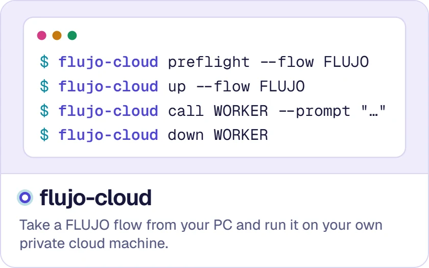</picture></a></td></tr>
<tr><td width="50%" valign="top"><a href="https://github.com/flujo-app/seagulled"><picture><source media="(prefers-color-scheme: dark)" srcset="assets/tiles/seagulled-dark.webp">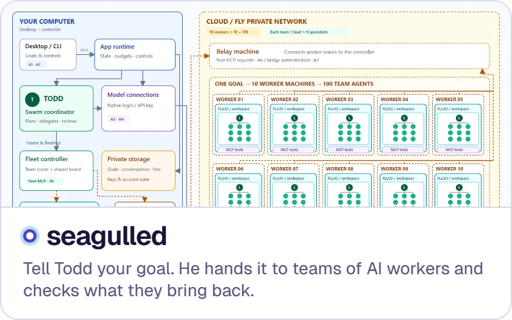</picture></a></td><td width="50%" rowspan="2" valign="top"><a href="https://github.com/flujo-app/brain"><picture><source media="(prefers-color-scheme: dark)" srcset="assets/tiles/brain-dark.webp">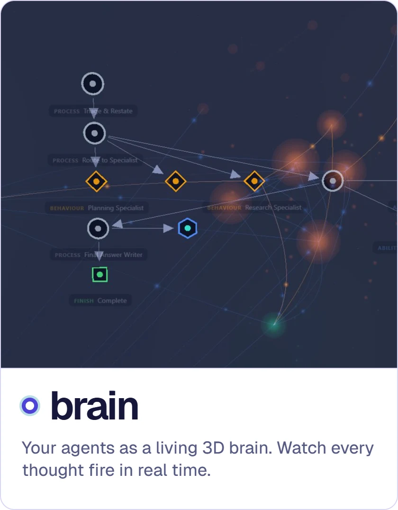</picture></a></td></tr>
<tr><td valign="top"><a href="https://github.com/flujo-app/CommunityAI"><picture><source media="(prefers-color-scheme: dark)" srcset="assets/tiles/communityai-dark.webp">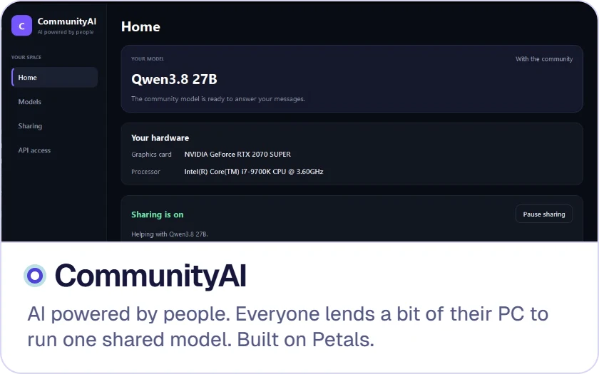</picture></a></td></tr>
</table>

 

<picture><source media="(prefers-color-scheme: dark)" srcset="assets/tiles/s-studios-dark.webp"></picture>

<table>
<tr><td width="50%" rowspan="2" valign="top"><a href="https://github.com/flujo-app/mcp-virtual-computer"><picture><source media="(prefers-color-scheme: dark)" srcset="assets/tiles/virtual-computer-dark.webp">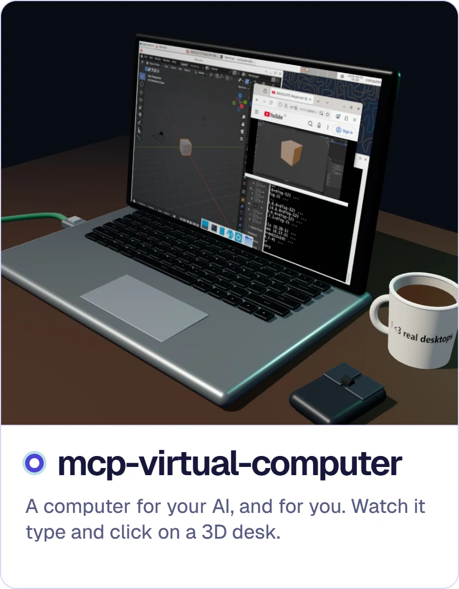</picture></a></td><td width="50%" valign="top"><a href="https://github.com/flujo-app/mcp-audio-studio-mcpapp"><picture><source media="(prefers-color-scheme: dark)" srcset="assets/tiles/audio-studio-dark.webp">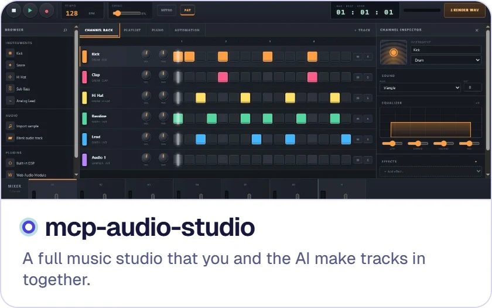</picture></a></td></tr>
<tr><td valign="top"><a href="https://github.com/flujo-app/mcp-vscode-mcpapp"><picture><source media="(prefers-color-scheme: dark)" srcset="assets/tiles/vscode-dark.webp">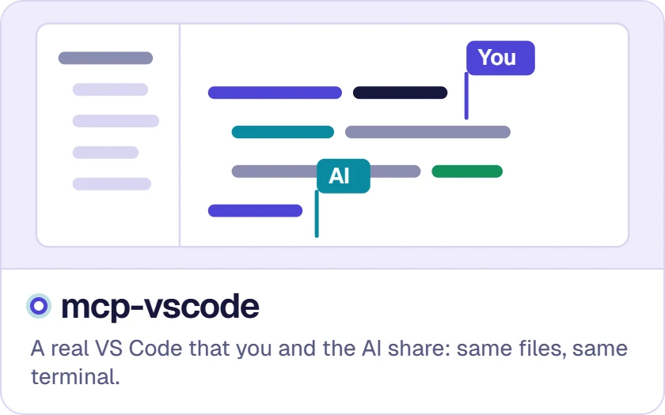</picture></a></td></tr>
</table>

<table>
<tr><td width="33%" valign="top"><a href="https://github.com/flujo-app/mcp-cad-studio"><picture><source media="(prefers-color-scheme: dark)" srcset="assets/tiles/cad-studio-dark.webp">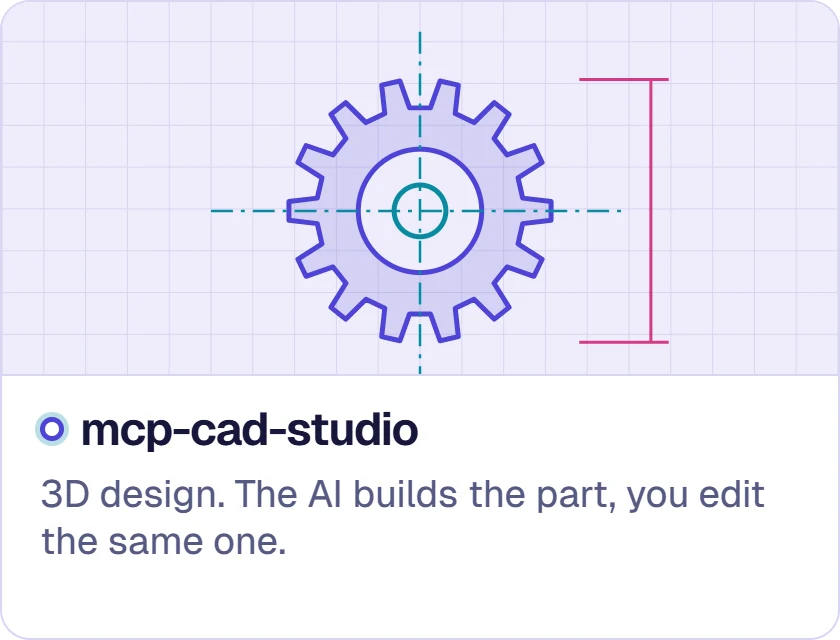</picture></a></td><td width="33%" valign="top"><a href="https://github.com/flujo-app/mcp-sandbox-computer-vm-for-ai"><picture><source media="(prefers-color-scheme: dark)" srcset="assets/tiles/sandbox-dark.webp">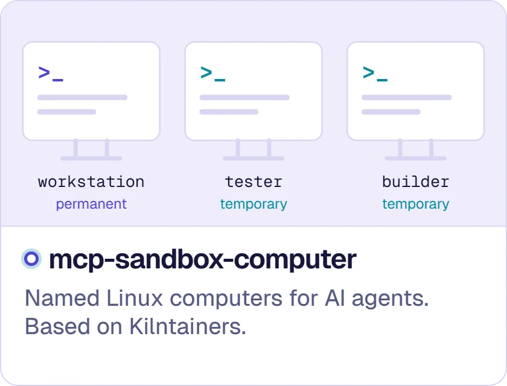</picture></a></td><td width="33%" valign="top"><a href="https://github.com/flujo-app/mcp-video-studio"><picture><source media="(prefers-color-scheme: dark)" srcset="assets/tiles/video-studio-dark.webp">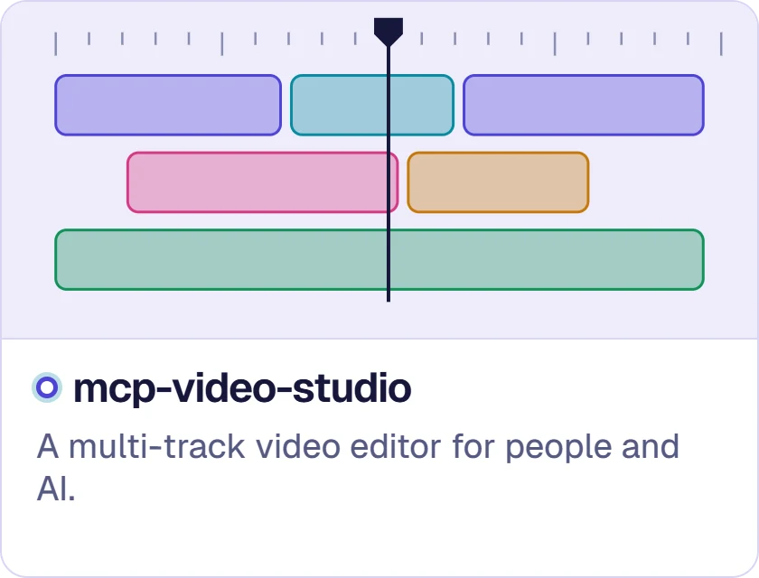</picture></a></td></tr>
</table>

 

<picture><source media="(prefers-color-scheme: dark)" srcset="assets/tiles/s-systems-dark.webp"></picture>

<table>
<tr><td width="33%" valign="top"><a href="https://github.com/mario-andreschak/mcp-abap-adt"><picture><source media="(prefers-color-scheme: dark)" srcset="assets/tiles/abap-adt-dark.webp">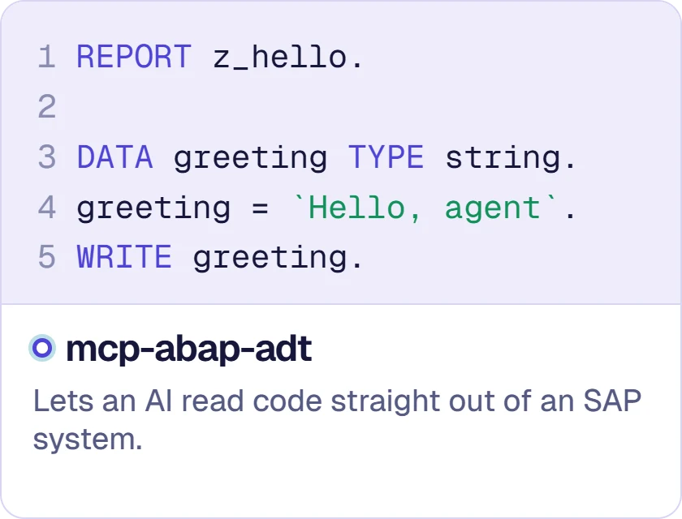</picture></a></td><td width="33%" valign="top"><a href="https://github.com/mario-andreschak/mcp-sap-gui"><picture><source media="(prefers-color-scheme: dark)" srcset="assets/tiles/sap-gui-dark.webp"></picture></a></td><td width="33%" valign="top"><a href="https://github.com/mario-andreschak/mcp-windows-desktop-automation"><picture><source media="(prefers-color-scheme: dark)" srcset="assets/tiles/windows-automation-dark.webp">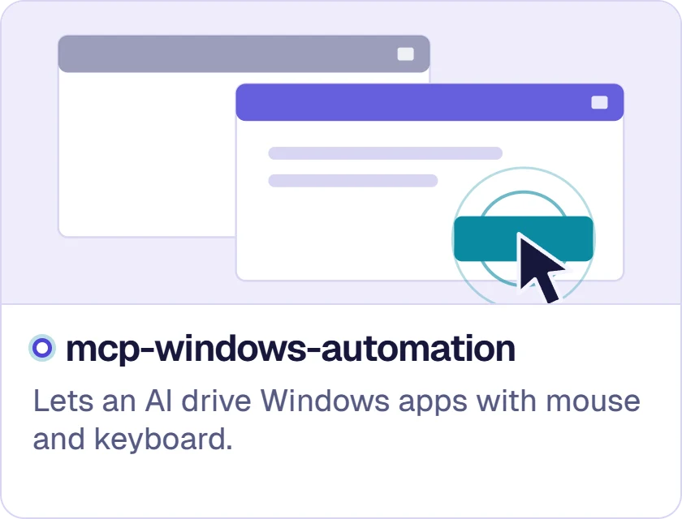</picture></a></td></tr>
</table>

 

<picture><source media="(prefers-color-scheme: dark)" srcset="assets/tiles/s-fun-dark.webp"></picture>

<a href="https://github.com/flujo-app/ai-fruit-fly"><picture><source media="(prefers-color-scheme: dark)" srcset="assets/tiles/fruit-fly-dark.webp">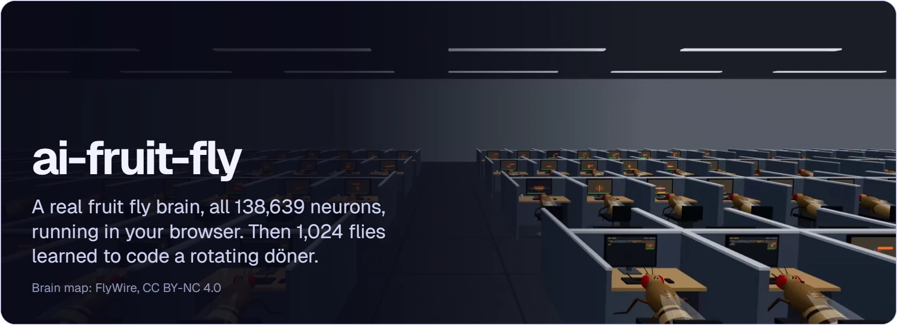</picture></a>

 

Also: <a href="https://github.com/mario-andreschak/mcp-gameboy">mcp-gameboy</a>, lets an AI play a Game Boy emulator · <a href="https://github.com/flujo-app/flujo-avatar">flujo-avatar</a>, talking eyes that live in a world built from your FLUJO setup · <a href="https://github.com/mario-andreschak/mcp-abap-abap-adt-api">mcp-abap-abap-adt-api</a>, the full toolbox for SAP ABAP development · <a href="https://github.com/flujo-app/mcp-stdio-oauth">mcp-stdio-oauth</a>, safer sign-in for local AI tools.
